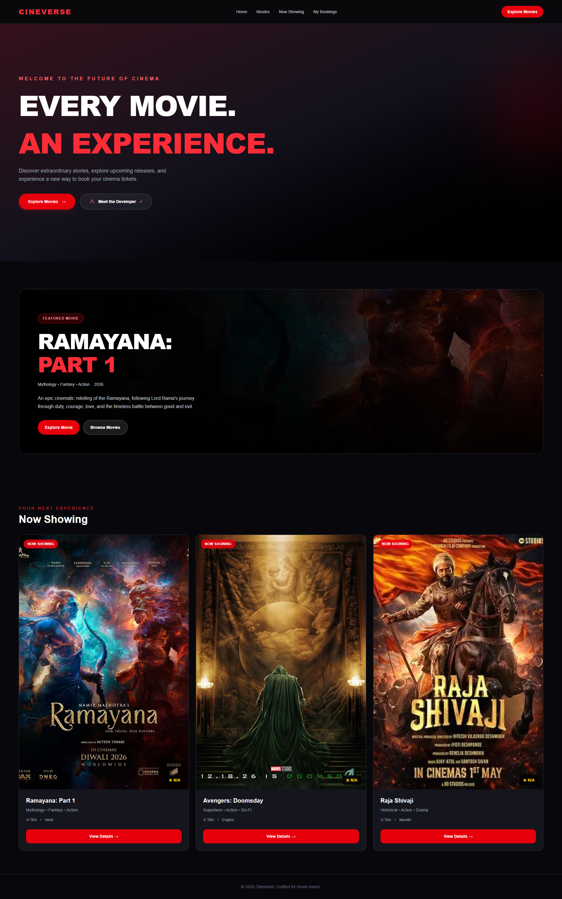
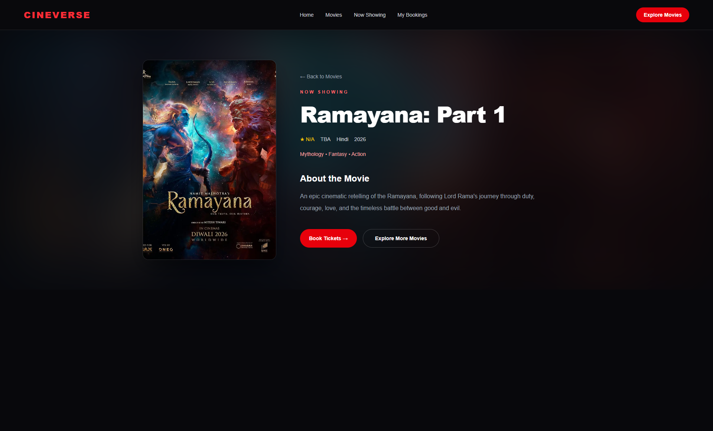
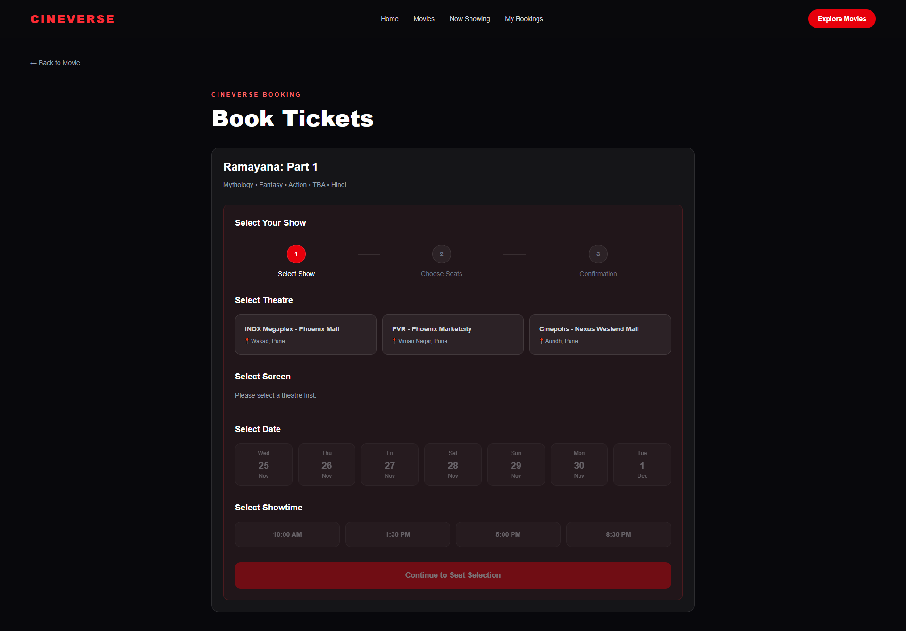
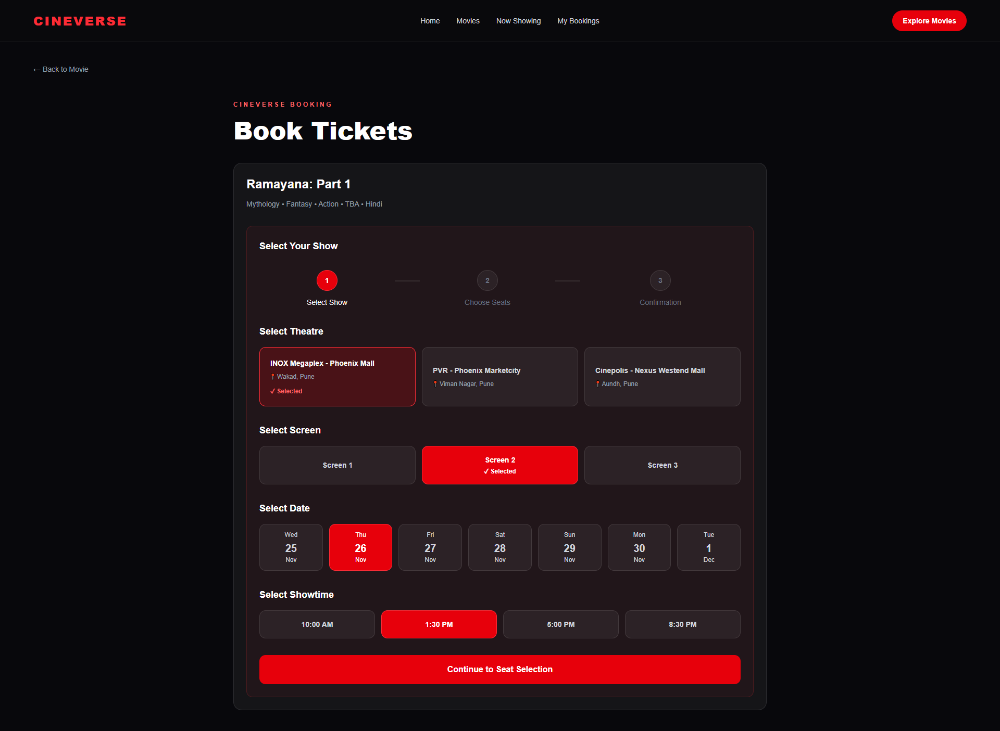
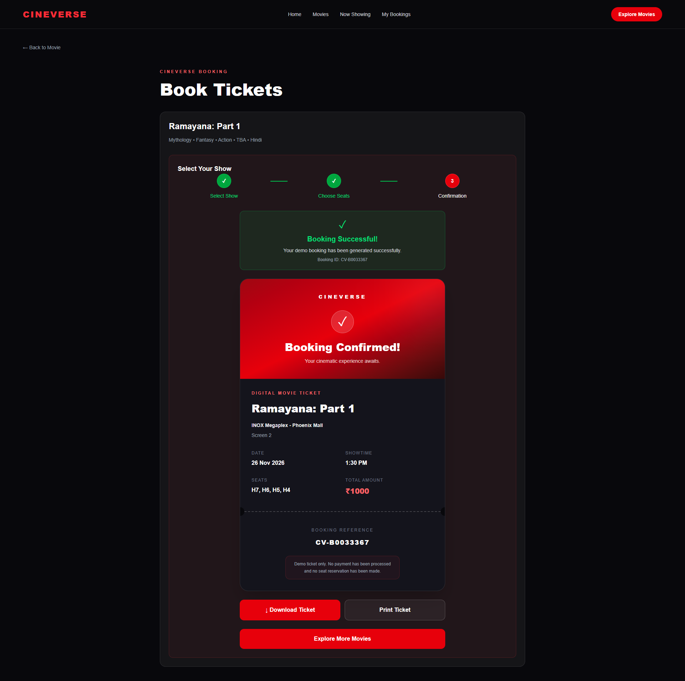
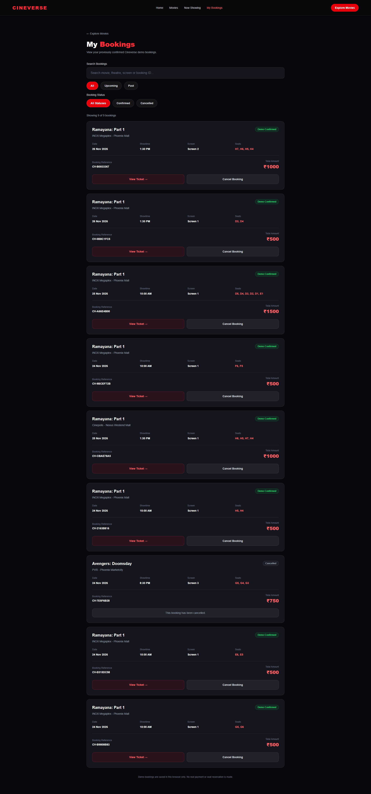
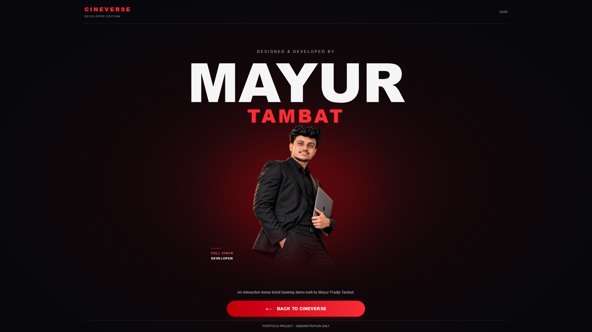
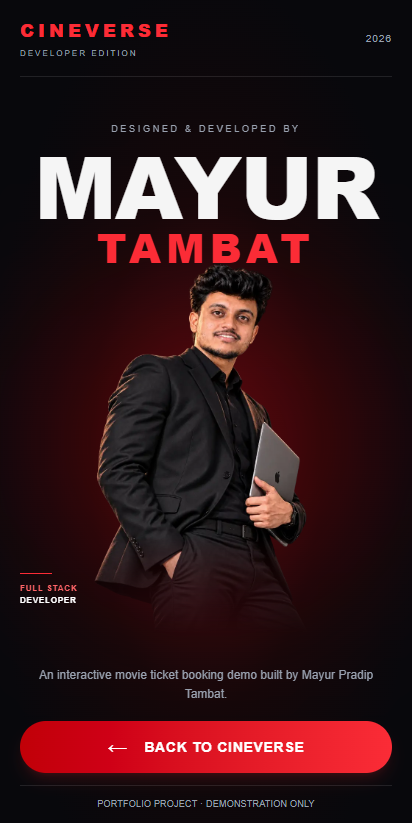
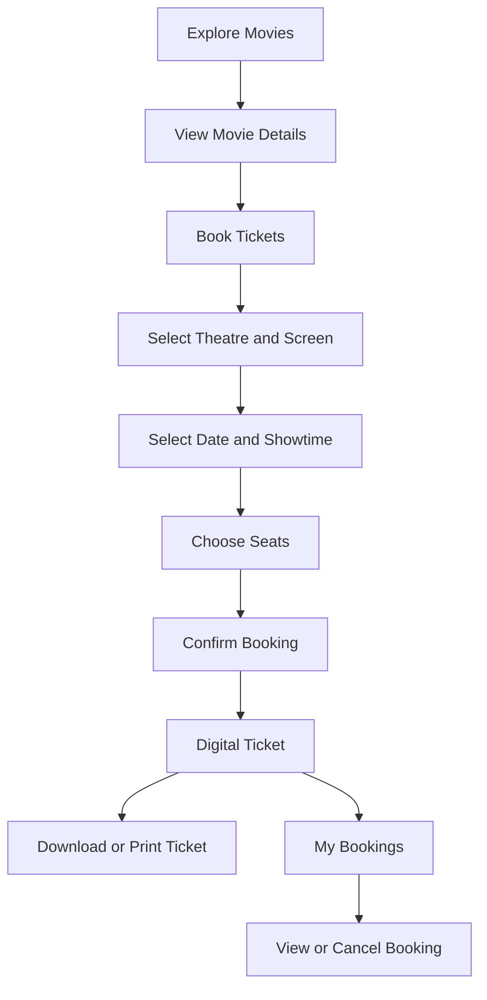

<div align="center">

# 🎬 CINEVERSE

### Every Movie. An Experience.

A modern, cinematic movie ticket booking experience built with Next.js, TypeScript, Tailwind CSS, GSAP and Lenis.


**Explore Movies · Select Showtimes · Choose Seats · Experience Cinema**

[About the Project](#-about-the-project) •
[Features](#-key-features) •
[Installation](#-getting-started) •
[Developer](#-developer)

</div>

---

## 🌐 Live Demo

**Coming soon — Vercel deployment in progress.**

---

## 📖 About the Project

Cineverse is a modern movie ticket booking demonstration platform designed to deliver an immersive and seamless cinema booking experience.

The application combines cinematic visual design, smooth animations, responsive layouts and an interactive booking workflow to simulate a real-world movie ticket booking platform.

This project was independently developed to demonstrate practical frontend development skills, modern web technologies, component-based architecture and user experience design.

---

## ✨ Key Features

### 🎥 Movie Discovery

- Cinematic homepage with immersive visuals
- Featured movie showcase
- Responsive movie cards
- Dedicated movie details pages
- Movie information, genres and descriptions

### 🎟️ Interactive Booking System

- Theatre and screen selection
- Date and showtime selection
- Past showtime restrictions
- Interactive cinema seat layout
- Available, selected and unavailable seat indicators
- Real-time ticket price calculation
- Booking confirmation with unique booking reference

### 📱 Digital Tickets

- Cinematic booking confirmation animation
- Digital movie ticket generation
- Downloadable PNG tickets
- Print ticket functionality
- Detailed booking information

### 📋 Booking Management

- View booking history
- Search existing bookings
- Filter upcoming and past bookings
- Filter confirmed and cancelled bookings
- View previously generated tickets
- Booking cancellation functionality
- Browser-based persistent storage using localStorage

### 🎨 User Experience

- Modern cinematic dark theme
- GSAP-powered animations
- Lenis smooth scrolling
- Responsive mobile, tablet and desktop layouts
- Loading animations and skeleton screens
- Custom 404 page
- Application error boundary
- Reduced-motion support

### 👨‍💻 Developer Showcase

- Dedicated developer profile page
- Cinematic developer introduction
- Accessible directly from the homepage
- Personalized portfolio presentation

---

## 📸 Project Screenshots

### 🎬 Cinematic Homepage

Discover an immersive cinema experience with featured movies,
cinematic animations and modern visual design.

<div align="center">
  
</div>

---

### 🎥 Movie Discovery & Showtime Selection

<table>
  <tr>
    <td align="center" width="50%">
      <b>Movie Details</b>
    </td>
    <td align="center" width="50%">
      <b>Theatre & Showtime Selection</b>
    </td>
  </tr>
  <tr>
    <td>
      
    </td>
    <td>
      
    </td>
  </tr>
</table>

---

### 🎟️ Interactive Booking Experience

<table>
  <tr>
    <td align="center" width="50%">
      <b>Interactive Seat Selection</b>
    </td>
    <td align="center" width="50%">
      <b>Booking Confirmation</b>
    </td>
  </tr>
  <tr>
    <td>
      
    </td>
    <td>
      
    </td>
  </tr>
</table>

---

### 📋 Booking Management

Manage bookings, view digital tickets, search booking history
and cancel reservations within the demonstration platform.

<div align="center">
  
</div>

---

### 👨‍💻 Meet the Developer

A dedicated cinematic developer showcase introducing
the creator behind Cineverse.

<div align="center">
  
</div>

---

### 📱 Mobile Experience

A responsive mobile-first experience designed for seamless
movie discovery and ticket booking across devices.

<div align="center">
  
</div>

---

## 🛠️ Technology Stack

| Technology    | Purpose                           |
| ------------- | --------------------------------- |
| Next.js 16    | Application framework and routing |
| React.js      | Component-based user interface    |
| TypeScript    | Type-safe application development |
| Tailwind CSS  | Responsive styling and layouts    |
| GSAP          | Cinematic animations              |
| Lenis         | Smooth scrolling experience       |
| HTML-to-Image | Digital ticket image generation   |
| LocalStorage  | Client-side booking persistence   |
| Git & GitHub  | Version control                   |
| Vercel        | Planned production hosting        |

---

## 🔄 Booking Workflow



---

## 🏗️ Project Structure

```text
cineverse/
│
├── public/
│   ├── developer/
│   └── posters/
│
├── src/
│   └── app/
│       ├── booking/
│       │   └── [slug]/
│       ├── components/
│       ├── data/
│       ├── developer/
│       ├── movies/
│       │   └── [slug]/
│       ├── my-bookings/
│       ├── utils/
│       ├── error.tsx
│       ├── globals.css
│       ├── icon.svg
│       ├── layout.tsx
│       ├── not-found.tsx
│       └── page.tsx
│
├── .gitignore
├── next.config.ts
├── package.json
├── package-lock.json
├── tsconfig.json
└── README.md
```

---

## 🚀 Getting Started

### Prerequisites

Make sure the following tools are installed:

- Node.js 22 or later
- npm
- Git

### 1. Clone the repository

```bash
git clone https://github.com/mayurtambat01/cineverse.git
```

### 2. Navigate to the project directory

```bash
cd cineverse
```

### 3. Install dependencies

```bash
npm install
```

### 4. Start the development server

```bash
npm run dev
```

Open the application in your browser:

```text
http://localhost:3000
```

---

## 📦 Production Build

Create an optimized production build:

```bash
npm run build
```

Start the production server:

```bash
npm run start
```

The application will be available at:

```text
http://localhost:3000
```

---

## ⚡ Performance & Optimization

- Next.js App Router architecture
- Static page generation
- Partial prerendering
- Optimized image rendering
- Responsive image layouts
- Client-side animation management
- SEO-friendly metadata
- Custom favicon and application branding
- Reduced-motion accessibility support

---

## 📊 Project Status

- [x] Core application development
- [x] Movie discovery and details pages
- [x] Theatre and showtime selection
- [x] Interactive seat selection
- [x] Digital ticket generation
- [x] Booking history and cancellation
- [x] Responsive design
- [x] Cinematic animations
- [x] Developer profile page
- [x] SEO and performance optimization
- [x] Successful production build
- [ ] Production deployment

---

## ⚠️ Disclaimer

Cineverse is an independent portfolio and educational demonstration project.

- No real movie tickets are issued.
- No actual payments are processed.
- Theatre information, showtimes and seat availability are demonstration data.
- Booking records are stored locally in the user's browser.
- The application does not use a live booking backend or shared seat reservation database.
- Movie titles, posters and associated trademarks belong to their respective copyright owners.

This project is not affiliated with any cinema chain, movie production company or commercial ticket booking platform.

---

## 👨‍💻 Developer

### Mayur Pradip Tambat

**Full Stack Developer | Computer Engineering Graduate**

Passionate about building modern, responsive and user-focused web applications using contemporary frontend and backend technologies.

Cineverse reflects my interest in interactive web experiences, modern application architecture, cinematic design and practical software development.

[](https://mayurtambat.vercel.app/)

[](https://github.com/mayurtambat01)

---

<div align="center">

### 🎬 CINEVERSE

**Every Movie. An Experience.**

Designed & Developed by **Mayur Pradip Tambat**

© 2026 Cineverse — Portfolio Demonstration Project

⭐ If you find this project interesting, consider giving the repository a star.

</div>
